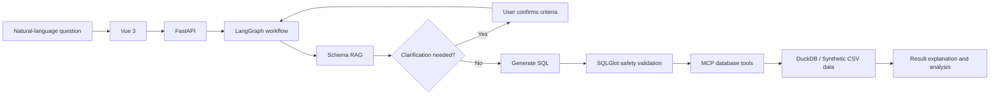

# Hengxi · Intelligent Business Data Query and Analytics Platform

[](README.md) [](README.en.md)

Hengxi (衡析) is a natural-language data query application for business analytics. Users ask questions in plain language, and the system retrieves relevant database schemas, clarifies business metrics when needed, generates and safely executes SQL, and returns tables, explanations, chart configurations, or analytical reports.

> The current version uses synthetic datasets included in this repository for local demonstrations and evaluation. It should not be connected directly to production databases or databases containing sensitive data.

## Key Features

- **Schema RAG**: Retrieves relevant fields using BM25, 1,024-dimensional embeddings, reciprocal rank fusion (RRF), and reranking, then builds a schema graph from table relationships.
- **Agent workflows**: Uses LangGraph to orchestrate request preprocessing, intent routing, database queries, and analysis of existing results.
- **Human-in-the-loop clarification**: Pauses when questions such as “best” or “most important” lack a ranking metric, then resumes after the user clarifies the criteria.
- **Safe execution and repair**: Uses SQLGlot to enforce read-only, single-statement queries and reject `SELECT *`, unknown tables, and unauthorized tables. Attempts at most one repair for recoverable SQL errors.
- **Result analysis**: Supports result tables, SQL inspection, Excel export, natural-language explanations, chart configurations, and analytical reports.

## Workflow



Tech stack: **Python, FastAPI, Vue 3, LangGraph, Qwen, MCP, DuckDB, and SQLGlot**.

## Chinese and English Queries

Ask questions in Chinese or English. The schema index includes English business synonyms such as `sales revenue`, `customer tier`, and `order count` alongside the Chinese vocabulary. Existing indexes are automatically rebuilt with the updated vocabulary on next use, requiring an available model service.

| Chinese | English |
| --- | --- |
| 按地区统计2026年8月实付销售额 | Show total paid sales by region for August 2026. |
| 按客户等级统计2026年8月实付销售额 | Show total paid sales by customer tier for August 2026. |
| 查询2026年8月表现最好的客户 | Find the best-performing customers in August 2026. |

- Answers, summaries, clarification prompts, newly generated SQL aliases, reports, and chart titles follow the question's language. Rankings such as `best` or `worst` require an explicit metric.
- Clarification replies retain the original query language. New questions in the same session can switch languages. Explicit requests such as `reply in Chinese` or `用英文回答` override the default.
- Mixed Chinese/English questions default to Chinese unless a language is specified. Quoted/backtick-enclosed values and identifiers are ignored for language detection. Numeric-only or punctuation-only requests default to Chinese.
- Source values, physical table/column names, and references to existing result columns remain unchanged. Chinese region names are not automatically translated. Application navigation and the schema browser remain primarily Chinese.

Offline paired tests use a model stub to verify the language policy and integration with the real workflow, MCP, and DuckDB; they do not measure live model accuracy. A separate [nine-pair bilingual suite](backend/evaluation/cases-bilingual.json) and [live benchmark runner](backend/evaluation/run_bilingual_benchmark.py) are provided:

```bash
cd backend
./.venv/bin/python -m pip install -r requirements-dev.txt
./.venv/bin/python -m pytest -q
# Requires LLM_API_KEY and consumes model credits.
./.venv/bin/python evaluation/run_bilingual_benchmark.py
```

The benchmark records status, reference SQL result agreement, schema recall, and a language-review hint for each language. Column aliases may differ; data values should match. Language detection is only a review aid and generated text should be checked manually. This live bilingual suite has not yet been run; the historical results below come from Chinese questions.

## Evaluation Results

The fixed evaluation set includes two synthetic databases, 30 unambiguous queries, and 10 questions with ambiguous business criteria. It covers aggregation, time filtering, ratio calculations, and joins across two to four tables.

The following results are from the repository's evaluation report dated September 24, 2026:

| Metric | Result |
| --- | ---: |
| Required schema field recall | **96.0% (120/125)** |
| Queries with all required schema fields retrieved | **83.3% (25/30)** |
| SQL execution success rate | **100% (30/30)** |
| Strict result match rate | **80.0% (24/30)** |
| Clarification recall / precision | **100% (10/10) / 100% (10/10)** |
| End-to-end latency | **P50 29.48s / P95 51.00s** |
| Backend automated tests | **71/71 passed** |

A “strict result match” requires the model-generated result to match the reference SQL result in row and column structure and values. Successful SQL execution does not guarantee a correct business answer. See the [evaluation report (Chinese)](backend/evaluation/REPORT-v2.md) for methodology and failure analysis, and [extended-final.json](backend/evaluation/results/extended-final.json) for raw records.

## Quick Start

Prerequisites: Python 3.11, Node.js 20.19+, npm, and available model credits on Alibaba Cloud Model Studio (Bailian).

Run the following commands from a local clone of this repository.

### 1. Start the Backend

```bash
cd backend
python3.11 -m venv .venv
./.venv/bin/python -m pip install -r requirements.txt
cp .env.example .env
```

Set `LLM_API_KEY` in `backend/.env` to your own API key. Do not commit `.env` or place your API key in frontend code.

```bash
./.venv/bin/python run.py
```

### 2. Start the Frontend

In a separate terminal, start from the repository root:

```bash
cd frontend
npm install
npm run dev
```

Open `http://127.0.0.1:5173`. The first query builds the schema vector index and may incur a small model API charge.

### 3. Demo Accounts

| Username | Password | Data Access |
| --- | --- | --- |
| `sales` | `sales123` | E-commerce operations data |
| `mock` | `mock123` | Basic sales data |
| `admin` | `admin123` | All demo datasets |

Try these sample prompts. The original Chinese prompts are included so you can copy them directly; English translations explain their meaning.

| Sample Prompt | English Translation |
| --- | --- |
| `按地区统计2026年8月销售额` | Summarize sales revenue for August 2026 by region. |
| `按客户等级统计2026年8月销售额` | Summarize sales revenue for August 2026 by customer tier. |
| `查询2026年8月表现最好的客户` | Find the best-performing customers in August 2026. |

## Tests

```bash
cd backend
./.venv/bin/python -m pytest -q
```

## Current Limitations

- All datasets are synthetic. The application has not yet been validated with real enterprise data, high-concurrency workloads, or production deployments.
- Strict result accuracy is lower for difficult queries than for easy and medium queries. Review the SQL, time range, and metric definitions before relying on important conclusions.
- DuckDB is used for local, read-only analytics. Production integrations should use read-only accounts, access isolation, or an enterprise data warehouse.
